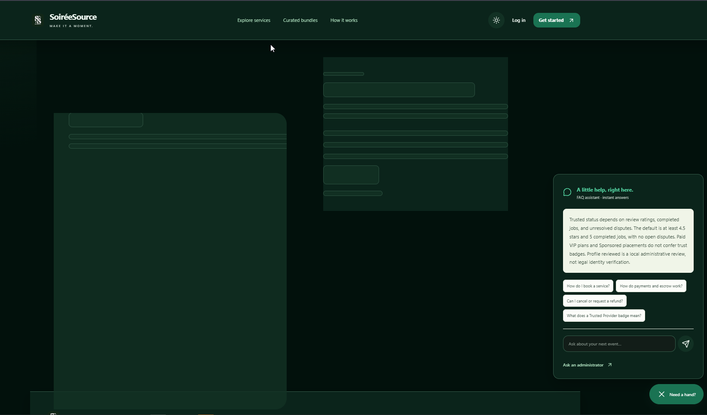

                            # Customer demo QA — 22 October 2026

**Verdict: core marketplace journeys work, but do not give an unrestricted demo sign-off yet.** Fix the email-edit login defect and FAQ intent errors before demonstrating those flows. Customer-to-admin support works as a request/reply ticket, but does not meet an ongoing-chat expectation. Current workspace typechecking also needs repair before a clean production-build rehearsal.

**Final coverage:** 35/35 existing business integration tests passed on real PostgreSQL; one additional email regression failed. Across 17 browser scenarios, 15 passed after correcting a new test's navigation timing and allowing sufficient accessibility audit time; two FAQ scenarios remain failed. A separate local production-like feature-flag scenario passed. Automated accessibility: zero violations across 39 routes in light and dark themes. This is not a claim that the full release command passed.

## Scope and environment

Customer discovery, registration/login/logout, profile, bookings, bundles, simulated checkout, verification gates, vouchers/rewards, notifications, FAQ/Q&A, public appeals, customer-provider messaging, and customer-to-administrator support. Provider and administrator actions are included where necessary to complete the customer journey.

Testing uses synthetic fixtures on loopback only. No production account, booking, message, notification, or database was changed. Source: local `phase2a/meeting-two-feedback` at `ec9602e` plus existing documentation changes. This is not certification of the deployed version or every browser/device combination.

## Findings and reproduction

### QA-00 — High: profile email capitalization breaks future login

Reproduced against real PostgreSQL with a newly registered synthetic account:

1. Register a customer using a lowercase email and valid password.
2. Save the same email in uppercase through the profile update operation.
3. Attempt to sign in with the original email and correct password.
4. Actual: `401 Email or password is incorrect.` Expected: successful login.

`updateProfile` preserves the submitted email's capitalization, while registration/login lowercase it and login queries with case-sensitive equality. This can leave a user unable to sign in after a successful profile save. The separate regression test intentionally fails on current behavior: `tests/demo-account-regression.test.ts`; evidence: `artifacts/qa-demo-email-regression-2026-10-22.log`.

Normalize email consistently before uniqueness checks and persistence. Audit any pre-existing mixed-case duplicates before applying a case-insensitive uniqueness constraint. Add tests for lowercase/uppercase login, case-only edits, and collisions with another account. This defect was reproduced at the application-service/database boundary; the normal profile-edit browser test separately exercises UI persistence.

### QA-01 — High: administrator support is not an ongoing customer chat

The customer submits a subject and message at `/support`; the administrator responds at `/admin/support`. The customer ticket has no follow-up composer. The database holds one `response`, and `respondTicket` overwrites that value on each update. There is no customer-visible reply history or automatic incoming-reply refresh in this page.

Demo impact: a presenter cannot conduct an ongoing user/admin conversation. Describe it as an asynchronous support request unless the feature is extended. Customer-provider booking messaging is a separate implementation and must not be presented as administrator chat.

Recommended acceptance criteria: append-only support messages with author/time; customer follow-up; admin replies; unread state; clear open/resolved/reopened behavior; refresh or polling; server-side participant checks; per-user rate limits; preserved history; escalation context from Q&A.

Evidence: `features/account/pages.tsx` SupportPage, `features/admin/operations.tsx` AdminSupport, `server/management.ts` createTicket/respondTicket. Browser reproduction is included in `tests/e2e/z-demo-qa.spec.ts`.

Browser result: request creation, admin notification, first reply, customer notification, mark-all-read, second reply, account isolation, rejection of customer attempts to use the admin response action (403), short-input validation (400), and safe rendering of HTML-like input all passed. The second reply replaced the first, and the ticket contained no customer reply field. Mobile screenshot: `artifacts/demo-qa/support-mobile.png`.

### QA-02 — High: FAQ gives incorrect answers to valid questions

Enter `How do the two verification gates work?` into Q&A. Expected: Gate 1/Gate 2 explanation. Actual: Trusted Provider badge explanation. Direct execution confirms only 9 of the 10 canonical FAQ questions map to their own answer.

Root cause: substring keyword counts with first-entry tie resolution. `verification` matches badges while `gate` matches handshake, producing a tie. The same approach can confuse booking, cancellation, payments, and account questions. The assistant has no conversation history or account-specific lookup.

Additional direct execution evidence (`artifacts/demo-qa/faq-direct.json`):

| Input | Actual intent | Verdict |
|---|---|---|
| Can I cancel my booking? | How to create a booking | Incorrect; should explain cancellation |
| How do I pay for my booking? | How to create a booking | Incorrect; should explain simulated payment/checkout |
| What is my booking status? | How to create a booking | Incorrect intent; should direct the customer to their booking or clarify the limitation |
| How do I reset my password? / I forgot my password | No FAQ match | Appropriate support fallback; recovery itself remains absent |
| Paano mag-book ng photographer? | How to create a booking | Relevant English answer, triggered by the word `book`; not evidence of multilingual understanding |
| zxqv unrelated question | No FAQ match | Appropriate support fallback |

Recommended fix: canonical-question matching first, token/phrase-aware intent matching, ambiguity handling, and explicit fallback for account-specific questions. Keep regression examples. AI is optional; basic correctness should not wait for an AI integration.

### QA-03 — Medium: Q&A escalation loses the question

The escalation link is always `/support#ticket`; `ask()` clears the input, and the answer state is local to the component. There is no question/transcript field passed to support. Anonymous users must sign in, which also does not preserve a support draft through this link.

Expected: a deliberate “Send this question to support” action carries the question and relevant conversation context into a reviewable support request. Do not automatically submit it without a user action.

### QA-04 — High for release preparation: current workspace fails typecheck

`npm run typecheck` and the real-PostgreSQL `npm run verify:release` stop with:

```text
artifacts/phase1-compat/app/[[...path]]/page.tsx(240,25): error TS2741:
Property 'user' is missing in type '{}' but required in type '{ user: User; }'.
```

`tsconfig.json` includes every `.ts`/`.tsx` and excludes only `node_modules`; the ignored historical source copy is therefore compiled. This is a local workspace contamination issue, not evidence of a production outage. Exclude generated/historical artifacts from TypeScript's source set or relocate the compatibility copy before the demo build.

### QA-05 — Low: stale demo/version wording

The sidebar says `Phase 1 · Local demo`; the payment FAQ also says `Phase 1`. Align the wording with the actual demonstration environment while keeping simulation disclosures prominent.

### QA-06 — Follow-up: self-service account recovery is absent

Source inspection found login/register/logout and account appeals, but no password-reset flow or change-password form. An account appeal does not restore access and sends no email. Treat account recovery as an unsupported scenario during the demo; do not imply the FAQ can reset passwords.

## AI integration proposal

The current assistant is deterministic FAQ matching, not AI. Start with a small, grounded support assistant rather than autonomous booking/payment actions.

| Stage | Capability | Integration | Acceptance criteria |
|---|---|---|---|
| 1 | Policy-grounded Q&A in English and Filipino/Taglish | Server endpoint retrieves approved FAQ/policy entries, sends only those passages to a model, returns an answer with source links | Correct gates/cancellation/payment answers; no invented refunds or prices; ambiguous questions ask for clarification; unavailable service falls back to FAQ/support |
| 2 | Human handoff with context | Customer reviews question/transcript before creating a support conversation; administrator sees summary plus original text | No lost question, explicit AI/admin labels, preserved conversation, customer controls submission |
| 3 | Administrator reply drafts and ticket triage | Model suggests category, summary and draft reply using authorized ticket content | Administrator edits and explicitly sends; model never silently sends or resolves tickets; original text remains available |
| 4 | Read-only booking assistant | Narrow server tools fetch only the signed-in user's booking state and explain the next permitted action | Ownership enforced in application code, no arbitrary SQL, no access to another customer's booking, no mutation tools |
| 5 | Service discovery from an event brief | Extract date/budget/location/category into validated filters and query the existing catalog | Prices and availability come from current records; visible filter chips; sponsored rankings remain labeled |

Suggested flow: chat UI → authenticated/rate-limited server endpoint → approved knowledge or authorized read-only tools → model → cited answer or support handoff. Keep API credentials server-side. With only ten FAQ topics, a curated knowledge collection is sufficient initially; a vector database is not a prerequisite.

Vercel AI SDK is a possible TypeScript integration layer supporting streaming and multiple model providers ([official overview](https://vercel.com/ai-sdk)). Grounded answers can use retrieved passages with attribution; Claude documents a search-result citation mechanism ([official documentation](https://platform.claude.com/docs/en/build-with-claude/search-results)). These are implementation options, not a commitment to a paid provider. Select a model after testing quality, latency, privacy requirements, and cost on the project's actual questions.

Before enabling AI, define data retention, redact unnecessary personal data, cap requests/output/spend, and add timeouts and a non-AI fallback. Never allow the model to approve refunds, alter bookings, reveal QR secrets, suspend accounts, or override authorization. Treat user messages and retrieved content as untrusted instructions.

AI evaluation set: all ten canonical FAQs, paraphrases, cancellation/payment collisions, Taglish, password recovery, unknown questions, unavailable model, prompt injection, cross-customer booking requests, and requests for real refunds in this simulated product. Require zero unauthorized disclosures/actions, source-supported policy answers, and successful human handoff. Record response latency, grounded-answer accuracy, escalation rate, and cost per conversation.

## Test infrastructure notes

- Original full release attempt could not start Docker.
- Windows reserves ports 55439 and 55441. Test-only loopback ports were changed to 15439 and 15441, with the browser server's isolation guard kept in sync.
- PGlite business tests passed 35/35. Browser PGlite attempts were discarded as inconclusive: single-connection rejection and multi-connection protocol errors. The temporary increased connection limit was reverted.
- PostgreSQL 17.10 binaries were downloaded into a disposable workspace directory without changing package dependencies. A loopback-only database was used for reliable browser testing, with a separate database for business integration tests.
- Feature-enabled browser testing uses all Phase 2 flags, including the simulated deposit and monetary-preview flags. A separate production-like flag scenario passed with messaging/cancellation/XP enabled and simulated deposits/monetary preview disabled. This verifies a local equivalent of the last recorded flag configuration, not today's live environment settings.

## Evidence and final execution results

Logs and screenshots are in ignored `artifacts/`; the added QA spec is retained in `tests/e2e/z-demo-qa.spec.ts`.

- Real PostgreSQL 17.10 business integration: **35 passed, 0 failed, 0 skipped**, approximately 37 seconds. Evidence: `artifacts/qa-demo-business-postgres-2026-10-22.log`.
- Additional email-edit regression: **1 failed**, reproducing QA-00. The original 35 passing tests did not cover this edge case.
- PGlite business integration: **35 passed, 0 failed, 0 skipped**. Evidence: `artifacts/qa-demo-business-2026-10-22.log`.
- Full release gate: **blocked by TypeScript failure QA-04** before lint/build/browser steps; no release pass claimed. Evidence: `artifacts/qa-demo-real-postgres-2026-10-22.log`.
- First real-PostgreSQL browser pass recorded **13 passed and 4 failed** across 17 scenarios. Two failures reproduce FAQ defects. The profile/discovery test used a non-retrying assertion immediately after navigation; corrected to wait for a visible service card. The accessibility sweep reached its 300-second timeout; its artifact recorded zero violations, but the test is not counted as passed from that attempt. Targeted retries use a 600-second accessibility budget and the corrected assertion.
- Clean development-browser probe recorded **zero errors** on `/`, `/browse`, `/login`; this is a narrow probe, not evidence that every route was console-error-free. Earlier broad-run logs included hydration warnings. Evidence: `artifacts/rc1-development-hydration.json`.
- Targeted ESLint checks passed for the added tests and adjusted test helpers.
- Targeted browser retry: **3/3 scenario results passed**: production-like flags, axe accessibility, and customer profile/discovery/logout. The accessibility audit took approximately 5.9 minutes; the 600-second test budget was sufficient. Evidence: `artifacts/qa-demo-production-flags-2026-10-22.log` and `artifacts/axe-wcag22aa.json` (completed 22 October 2026, 13:58 PHT).
- Combining unique scenario results after those harness corrections: **15/17 browser scenarios passed; 2 failed due to FAQ defects**. The customer-support scenario passes by verifying the current ticket behavior and explicitly detecting its limitations; it does not certify threaded chat.
- The Windows Playwright development-server trees lingered after printing individual results; they were explicitly stopped after all scenario outcomes were recorded. No normal overall runner exit-code success is claimed from those runs.
- Visually reviewed generated home-mobile, support-desktop, and support-mobile screenshots. The mobile support ticket fits the viewport; HTML-like input remains visible as literal text.

### Retained changes

- Added `tests/e2e/z-demo-qa.spec.ts` for profile/discovery/logout, canonical and natural-language FAQ questions, and the complete customer-admin support path.
- Added `tests/demo-account-regression.test.ts` to reproduce the email case defect against an explicitly guarded, migrated disposable `soiree_business_test` database.
- Adjusted only test infrastructure: local emulator ports and matching isolation guard; increased the full accessibility suite's timeout. No application feature, production configuration, or customer record was changed.
- The added defect regressions intentionally remain failing until application fixes are made. Existing unrelated documentation edits were preserved.

| Customer feature | Coverage performed |
|---|---|
| Registration/session security | Password hashing, Terms version/consent, welcome benefits, invalid public admin registration, persisted sessions, suspension invalidation |
| Discovery | Rating/price ordering independent of paid priority; expired promotions; browser category filtering, service/provider pages and responsive layouts |
| Profile | Customer profile edit/reload persistence and logout regression added; referral/review views included in existing lifecycle coverage |
| Individual booking | Quote/package/guest/calendar constraints; request/accept/payment state rules; unique reservation; complete lifecycle |
| Bundles | Participant approval, intersected availability, all-provider acceptance and completion, per-provider message isolation |
| Vouchers/rewards | Expired/future/rank/category/owner/minimum/capped constraints; reservation/reuse prevention; referrals once; loyalty check-in idempotency |
| Simulated money | Mock escrow, dispute freeze, admin authorization and confirmation, refund idempotency, append-only ledger, separate deposit prototype |
| Verification/reviews | Token expiry, wrong attempts, single-use, item/gate/counterparty ownership; incomplete booking cannot be reviewed |
| Cancellation/expiry | 24-hour response expiry; legacy rows preserved; cleanup and notification idempotency; Philippine-date review boundary |
| Booking messages | Participant isolation, suspended users, read cursors, notifications; browser send/reply and escaping payload text |
| Notifications | Visit-driven and scheduled reminder idempotency; customer support notification and mark-read browser regression added |
| Public account appeal | Rate limits, admin-only review, generic confirmation, no automatic account restoration |
| FAQ/Q&A | Ten canonical questions; seven realistic/unsupported/Taglish questions; anonymous escalation; mobile display |
| Administrator support | Customer request, admin notification/reply, customer notification, account isolation, validation, unauthorized reply rejection, text escaping, reply replacement and absent follow-up composer |
| Appearance/accessibility | Existing light/dark persistence, responsive widths, contrast and automated axe suite; targeted support screenshots |

Remaining limits: desktop Chromium only; responsive emulation is not physical-device testing; screen-reader/manual keyboard certification, email/SMS, camera scanning, real payments, load/soak tests and live-production user mutations are not covered. No feature should be described as fully tested solely because its route renders.

## Demo rehearsal guidance

1. Use a known disposable demo dataset and separate browser profiles for customer, provider and administrator.
2. Demonstrate discover → request → provider accept → mock checkout → both verification gates → review. Explicitly label all payments as simulated.
3. Demonstrate booking messaging separately from administrator support. For support, submit a request, switch to admin, reply, then refresh the customer's support page and check notifications.
4. Until QA-02 is fixed, use the static FAQ accordion for verification-gate instructions; do not represent the keyword assistant as AI or promise reliable free-form answers.
5. Resolve the local typecheck contamination and rehearse a production build before the actual demo. Dev-only hydration errors and issue badges should not be mistaken for a clean production-mode verification.
6. Confirm the chosen demo feature flags. Enabling simulated-deposit and monetary-concept previews changes what the presenter sees; neither is a real payment or redeemable reward.
