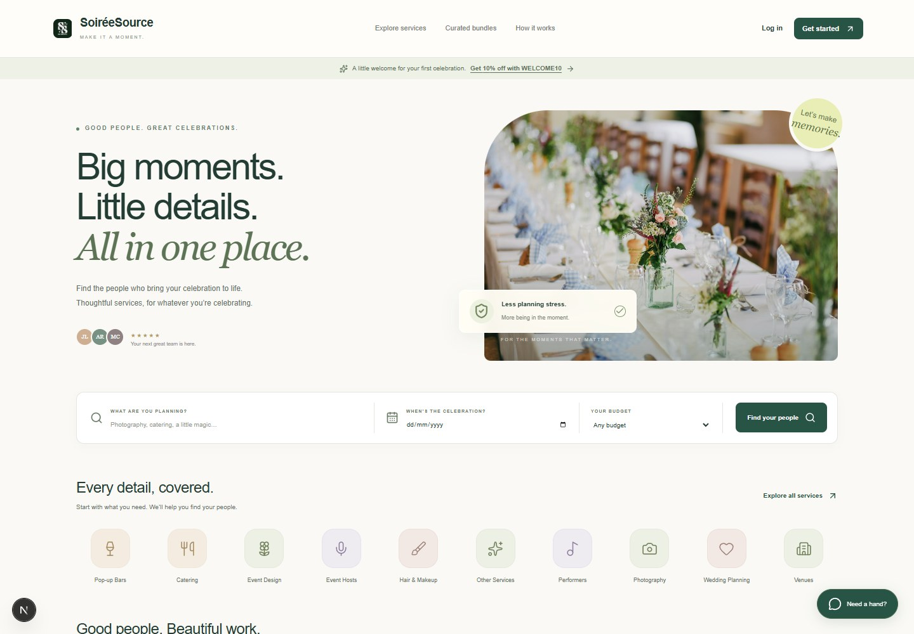
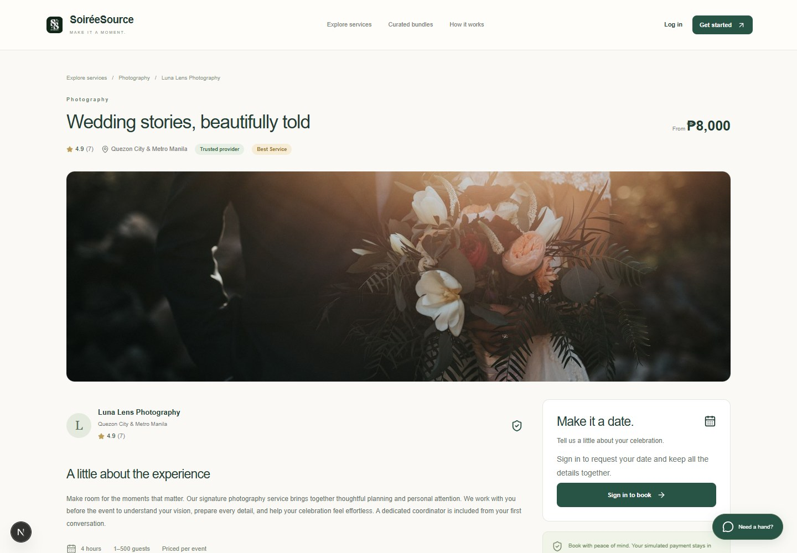
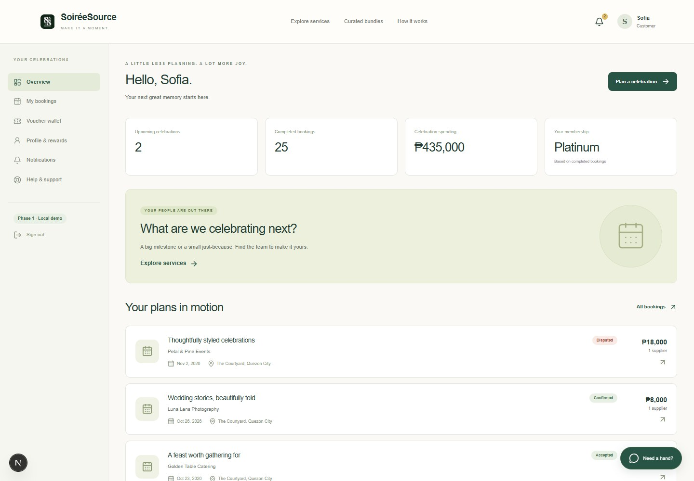
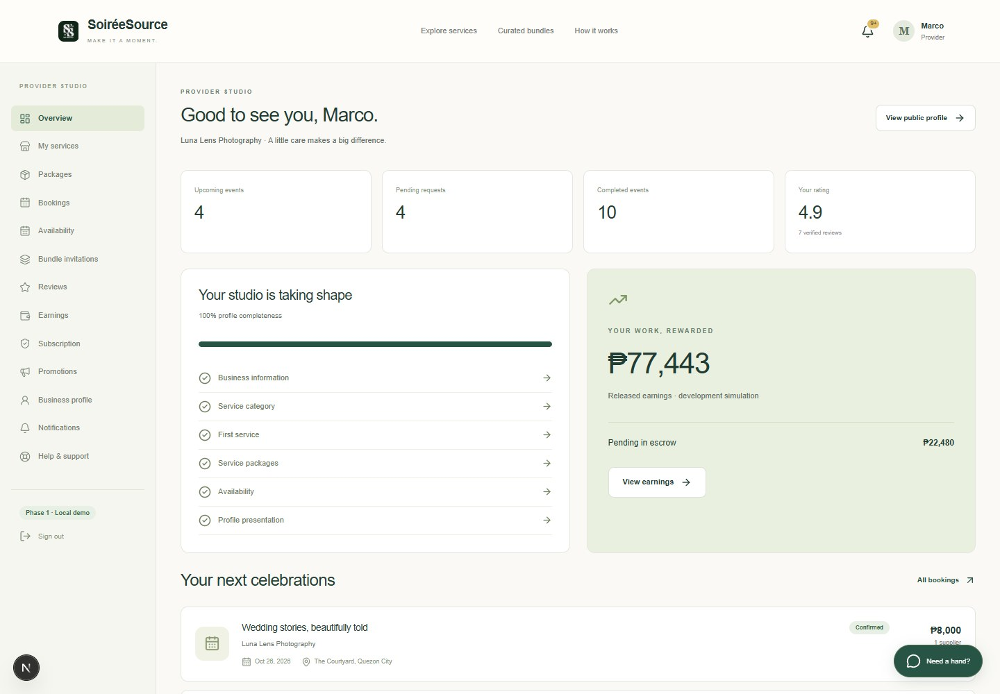
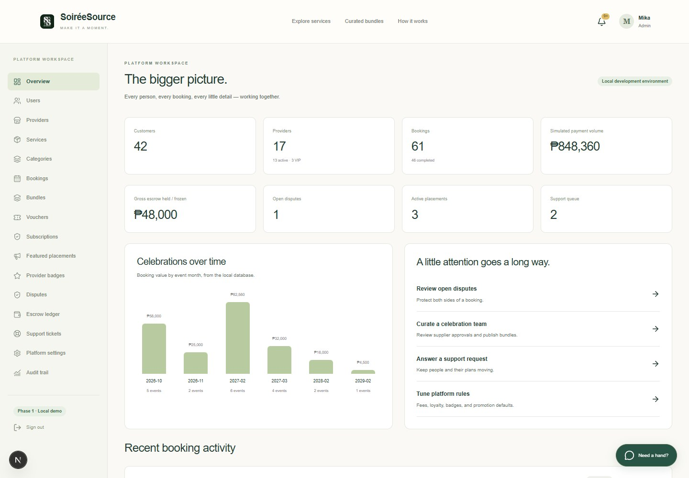

# SoiréeSource — ongoing full-stack client project

> A living case study of a commissioned event-services marketplace. This document reflects the repository and project status as of 6 October 2026 and should be updated as user acceptance testing and later phases continue.

## At a glance

|                              |                                                                                                                                                                 |
| ---------------------------- | --------------------------------------------------------------------------------------------------------------------------------------------------------------- |
| **Project**                  | A multi-role marketplace for event-related services                                                                                                             |
| **My role**                  | Full-stack developer responsible for product implementation, data architecture, security, testing, deployment support, and ongoing maintenance                  |
| **Current stage**            | Phase 1 deployed for client/user acceptance testing                                                                                                             |
| **Primary users**            | Customers, service providers, and platform administrators                                                                                                       |
| **Core stack**               | Next.js 16, React 19, TypeScript, Supabase PostgreSQL, Postgres.js, Vercel                                                                                      |
| **Notable engineering work** | Booking lifecycle design, SQLite-to-PostgreSQL migration, transactional data operations, role-based authorization, query consolidation, and safe public caching |
| **Repository**               | [Ralimations/CEBA-service-ecommerce](https://github.com/Ralimations/CEBA-service-ecommerce)                                                                     |

## Overview

SoiréeSource is an ongoing commissioned web application I am developing as a marketplace for event-related services. It brings discovery, booking, service coordination, and marketplace administration into one product instead of leaving customers and providers to manage the full process through disconnected messages and spreadsheets.

The platform currently supports three major user roles. Customers can discover individual services and curated bundles, request dates, manage bookings, use vouchers, receive notifications, and review completed services. Providers can manage their business profiles, services, packages, availability, bookings, bundle invitations, reviews, subscriptions, promotions, and earnings. Administrators can oversee users, providers, services, categories, bookings, bundles, vouchers, subscriptions, promotions, disputes, simulated escrow transactions, platform settings, support requests, and audit records.

Phase 1 is deployed and undergoing client/user acceptance testing. I am continuing to maintain the application, respond to feedback, resolve issues, and plan the next production integrations.

## The problem

Event planning is a multi-party workflow. A customer may need a photographer, caterer, host, stylist, venue, and other specialists for one date, while every provider has separate availability, terms, pricing, and responsibilities. A useful marketplace therefore needs to do more than display listings: it has to preserve agreements, coordinate provider decisions, prevent scheduling conflicts, and make the status of a booking understandable to everyone involved.

The product also needs different levels of control. Customers need a simple path from discovery to completion. Providers need a practical operating workspace. Administrators need enough visibility and intervention tools to manage trust, marketplace rules, disputes, and simulated financial records without bypassing the same business rules that protect ordinary users.

## My approach

I treated the booking lifecycle as the center of the system and built the surrounding marketplace around it.

1. **Discovery:** customers search and filter services, compare packages, view provider profiles and reviews, or choose an administrator-curated multi-provider bundle.
2. **Request and acceptance:** a customer submits event details; each relevant provider reviews the request. A provider's acceptance reserves the event date transactionally.
3. **Confirmation:** the customer completes a clearly labelled simulated checkout. The agreed package, pricing, discounts, fees, and provider allocation are stored as booking snapshots so later catalog edits do not change an existing agreement.
4. **Service delivery:** two expiring, single-use verification gates record the start and completion of each service. The customer and provider perform opposite sides of each handshake.
5. **Settlement and trust:** ordinary completion releases the simulated escrow allocation, unlocks verified reviews, updates customer loyalty progress, and can trigger referral rewards. Disputed cases remain frozen for an audited administrator decision.

For bundles, the same lifecycle operates at item level. Every provider must approve the administrator's proposed participation terms before a bundle can be published, and every participating provider must accept the customer's request before checkout can proceed.

## Role-based product surfaces

### Customer experience

The customer experience includes marketplace search, category and availability filters, individual and bundle discovery, package selection, booking requests, vouchers, notifications, booking timelines, mock checkout and escrow, the two-gate service handshake, support, and verified reviews. The dashboard is based on persisted bookings rather than placeholder totals.

### Provider operations

Providers have a separate workspace for onboarding, business information, portfolio entries, services, packages, add-ons, listing status, calendar availability, booking decisions, bundle invitations, reviews, simulated subscriptions and promotions, and earnings allocations. Ownership checks are enforced on the server rather than relying on hidden navigation.

### Administration

The administrator workspace covers users, providers, listings, categories, bookings, bundles, vouchers, subscriptions, paid placements, trust badges, disputes, support tickets, platform settings, simulated escrow, and an append-only audit history. Sensitive interventions require explicit confirmation and a recorded reason.

## Technical architecture

The application uses the Next.js App Router with React Server Components for most read-heavy views. A guarded catch-all route maps stable product URLs to feature modules for the public marketplace, accounts, bookings, provider tools, and administration. Mutations pass through validated API handlers into server-side domain functions, where authorization and business rules are checked again.

Supabase PostgreSQL is accessed through Postgres.js and a small parameterized repository layer rather than an ORM. The schema currently covers identity and sessions, provider catalogs, availability, bundles, bookings, reservations, voucher rules, simulated payments and escrow, reviews, subscriptions, placements, disputes, notifications, support, settings, and audit records.

The reliability model is deliberately database-backed:

- PostgreSQL transactions protect booking acceptance, date reservation, voucher use, mock payment, verification gates, settlement, and dispute resolution.
- Unique provider/date reservations prevent double booking.
- Booking items snapshot commercial terms and allocations.
- Audit, booking-event, and simulated escrow ledgers are append-only through database triggers.
- Passwords use salted scrypt hashes; session and handshake secrets are stored as hashes.
- Cookies are HttpOnly and SameSite=Lax, login attempts are throttled, and suspended accounts lose access.
- Money is stored as integer centavos, event-day comparisons use Asia/Manila, and operational timestamps are stored in UTC-compatible ISO form.

## Major engineering challenge: moving from SQLite to Supabase PostgreSQL

The first implementation used local SQLite because it made the complete Phase 1 workflow quick to build and test. The commissioned application then needed cloud-hosted persistence that could support deployment, shared testing, and future production work.

I migrated the data layer to Supabase PostgreSQL while preserving the application behavior and transactional boundaries. This was not a simple connection-string change. SQLite and PostgreSQL return and compare several values differently, especially aggregates, timestamps, booleans represented as integers, and `DISTINCT` queries with ordering.

The production-shaped verification pass surfaced issues that a successful HTTP response alone did not reveal because a streamed Server Component could still fail during rendering. I reproduced and fixed:

- PostgreSQL numeric aggregates reaching TypeScript as strings;
- text timestamps being compared with `timestamptz` values;
- a `SELECT DISTINCT` ordering error in booking queries;
- a reserved alias in the administrator's monthly totals query; and
- zero-valued aggregates being treated incorrectly in voucher eligibility.

I added a read-only PostgreSQL audit and browser/runtime smoke coverage for public pages, authentication, role dashboards, session behavior, terms acceptance, booking creation, and voucher logic. The detailed implementation record is in the repository's `POSTGRES_HOTFIX_REPORT.md`.

## Major engineering challenge: reducing database work

After the migration, the application was functionally correct but several pages performed repeated per-record reads. That pattern was inexpensive against a local database and costly across a remote connection.

I measured the production-shaped routes, replaced repeated loops with batched and set-based PostgreSQL reads, used JSON aggregation where it improved the data boundary, combined related dashboard counts, and added request-level memoization. I then enabled Next.js 16 Cache Components for safe public catalog data with explicit cache tags and post-commit invalidation.

Authenticated state, authorization, bookings, payments, escrow, notifications, and availability remain outside shared caching. Availability is intentionally read live because a reservation can change it at any time.

### Measured query reduction

| Route                   |     Before | After SQL optimization | Reduction |
| ----------------------- | ---------: | ---------------------: | --------: |
| Homepage                | 54 queries |              8 queries |       85% |
| Browse                  |         26 |                      3 |       88% |
| Service detail          |         31 |                      3 |       90% |
| Provider detail         |         34 |                      5 |       85% |
| Customer dashboard      |        125 |                      7 |       94% |
| Provider dashboard      |        101 |                     10 |       90% |
| Administrator dashboard |        256 |                      9 |       96% |
| Booking list            |         64 |                      5 |       92% |

The cached production run also demonstrated the intended warm behavior. The homepage moved from 6 queries and 1,972 ms on a cold request to 0 queries and 46 ms when warm. Service detail moved from 3 queries and 671 ms to 0 queries and 42 ms, while bundle detail moved from 2 queries and 532 ms to 0 queries and 23 ms. These are controlled local benchmark results against the configured remote database, not a guarantee of end-user latency in every deployment region.

I kept opt-in query instrumentation, cache lifetime checks, mutation invalidation tests, and regression coverage in the repository so later work can be compared against the same baseline.

## Quality and validation

The repository includes domain integration tests, PostgreSQL audits, public and authenticated route smoke checks, cache and connection regressions, responsive navigation checks, and Playwright browser journeys. The performance pass recorded:

- 23 of 23 isolated PostgreSQL business tests passing;
- type checking, ESLint, and the production build passing;
- 56 public and authenticated route checks passing;
- desktop and mobile navigation checks passing; and
- live cache invalidation and reservation regression coverage passing against Supabase.

The interface includes responsive layouts, contained data tables, keyboard focus treatment, labelled inputs, field-level errors, confirmation dialogs, empty and error states, reduced-motion styling, and route-aware skeleton loading states. This is meaningful accessibility work, but it is not presented as a formal accessibility certification.

## Current outcome

Phase 1 now provides a complete demonstrable marketplace lifecycle across customer, provider, and administrator roles, backed by cloud-hosted PostgreSQL. The application has moved beyond a catalog prototype: bookings reserve real database dates, preserve agreed terms, progress through controlled states, create persistent simulated financial records, and generate review and loyalty outcomes after completion.

The database optimization work removed the largest avoidable source of latency and established a safer caching boundary for public pages. The current codebase also has a stronger base for UAT because failures can be reproduced through runtime smoke tests and important writes are protected by transactions and database constraints.

## Honest boundaries

Phase 1 intentionally demonstrates several commercial workflows without claiming production integrations that are not present.

- Payments, subscriptions, promotions, refunds, earnings, and escrow are simulations. No real money moves through the platform.
- Notifications are stored in the application and reminders are generated during authenticated visits; there is no background email, SMS, or push service yet.
- Portfolio media uses local assets or validated image URLs; direct upload and cloud media processing are not implemented.
- Provider verification is an administrator-reviewed platform flag, not external KYC or business verification.
- Camera-based QR scanning, installments, partial refunds, partial bundle settlement, advanced analytics, and an automatic reservation timeout remain future work.
- Production operations still need continued monitoring, backup and recovery validation, stronger anti-abuse controls, and a dedicated isolated test project.

## What comes next

The immediate focus is UAT: collecting client feedback, resolving issues, validating deployment behavior, and deciding which Phase 2 integrations have the highest product value. The current roadmap includes production payment and payout providers, transactional email/SMS or push notifications, managed media storage, external verification where appropriate, deeper marketplace analytics, and additional discovery and coordination features.

Because this is an active client project, the case study will evolve with the product. The [repository timeline](TIMELINE.md) records the evidence available in Git, while [UPDATES.md](UPDATES.md) is the append-only place for future milestones, measurements, UAT findings, and release outcomes.

## Supporting records

- [Repository-backed development timeline](TIMELINE.md)
- [Ongoing update log](UPDATES.md)
- [Maintenance and publication guide](MAINTENANCE.md)
- [Phase 1 status](../../PHASE1_STATUS.md)
- [Phase 1 changelog](../../CHANGELOG_PHASE1.md)
- [PostgreSQL runtime hotfix report](../../POSTGRES_HOTFIX_REPORT.md)
- [Performance optimization report](../../PERFORMANCE_OPTIMIZATION_REPORT.md)
